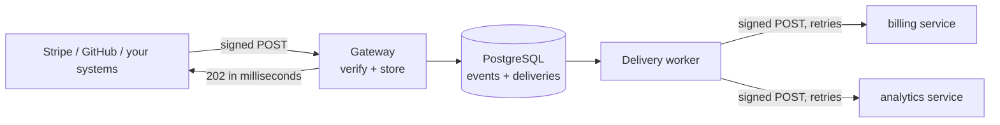

# Webhook Gateway

[](https://github.com/arkhan0072-dev/webhook-gateway/actions/workflows/ci.yml)

A small ASP.NET Core service that sits between webhook senders (Stripe, GitHub, your own systems) and the services that act on them. It **verifies** every incoming webhook, **stores** it before answering, and **delivers** it to one or more internal services with retries, so a deploy or an outage on your side never loses an event.

Built with .NET 9, ASP.NET Core minimal APIs, EF Core and PostgreSQL.

## Why

Webhook senders give up after a few retries, and each internal service ends up re-implementing signature checks, deduplication and retry logic. The gateway does that once:



## Features

- **Signature verification** for Stripe (`Stripe-Signature`, with a 5-minute replay window and support for rolled secrets), GitHub (`X-Hub-Signature-256`) and a generic HMAC-SHA256 header. All comparisons are constant-time, and a missing secret rejects everything rather than accepting everything.
- **Stored before acknowledged**: the body is kept byte for byte, so destinations can verify signatures over exactly what was sent.
- **Deduplication**: each event is stored once per source, keyed by the sender's id (Stripe event id, GitHub delivery id, or `X-Webhook-Id` / body hash), so sender retries do not cause double processing.
- **Fan-out**: one event can go to several destinations, each tracked separately.
- **Reliable delivery**: failures (error status, network error, timeout) are retried after 30s, 1m, 2m, 4m ... up to a cap, then dead-lettered.
- **Safe with many workers**: deliveries are claimed with `FOR UPDATE SKIP LOCKED`, so running several instances never sends the same delivery twice.
- **Signed forwarding**: each destination receives `X-Gateway-Signature-256` (HMAC of the body with its own secret), plus `X-Gateway-Event-Id`, `X-Gateway-Source` and `X-Gateway-Attempt`.
- **Admin API** to list dead deliveries and replay one or all of them after an outage.

## API

| Method | Path | Auth | Description |
|---|---|---|---|
| `POST` | `/webhooks/{source}` | sender's signature | Verify, store and queue. `202` new, `200` duplicate, `401` bad signature, `404` unknown source, `413` over 1 MB |
| `GET` | `/admin/deliveries?status=dead&limit=50` | `X-Api-Key` | Deliveries by status (`pending`, `delivered`, `dead`), newest first |
| `POST` | `/admin/deliveries/{id}/replay` | `X-Api-Key` | Send a dead or delivered delivery again; `409` if already queued |
| `POST` | `/admin/destinations/{name}/replay-dead` | `X-Api-Key` | Requeue every dead delivery for one destination |
| `GET` | `/health` | | Database check |

## Configuration

Sources and destinations are configuration, so secrets come from environment variables or a secret store, never from the database:

```json
"Gateway": {
  "AdminApiKey": "...",
  "MaxAttempts": 8,
  "RetryBaseDelay": "00:00:30",
  "MaxRetryDelay": "06:00:00",
  "Sources": {
    "stripe": { "Scheme": "Stripe", "Secret": "whsec_...", "Destinations": ["billing", "analytics"] },
    "github": { "Scheme": "GitHub", "Secret": "...", "Destinations": ["ci"] }
  },
  "Destinations": {
    "billing":   { "Url": "https://billing.internal/webhooks",   "Secret": "..." },
    "analytics": { "Url": "https://analytics.internal/webhooks", "Secret": "..." }
  }
}
```

As environment variables: `Gateway__Sources__stripe__Secret=whsec_...`. Deliveries store the destination's name, so a URL or secret can change without touching queued deliveries.

Set `Gateway:RunDeliveryWorker=false` to run an instance that only receives webhooks.

## Run it

Requirements: Docker.

```bash
docker compose up --build
```

The gateway listens on http://localhost:8080 with an example Stripe source. Set `STRIPE_WEBHOOK_SECRET`, `GATEWAY_ADMIN_API_KEY`, `BILLING_WEBHOOK_URL` and `BILLING_SIGNING_SECRET` in a `.env` file.

## Tests

60 tests: signature unit tests, and integration tests that run the real app (`WebApplicationFactory`) against PostgreSQL with a fake clock and fake destinations.

```bash
docker compose up -d db
dotnet test -p:CollectCoverage=true "-p:ExcludeByFile=**/Migrations/*.cs"
```

| Area | What is proven |
|---|---|
| Signatures | valid, tampered, wrong secret, missing header, malformed header, replay window edges, rolled secrets, empty secret |
| Ingest | stored byte for byte, one delivery per destination, duplicates acknowledged once, size limit, unknown source |
| Delivery | original body and content type forwarded, gateway signature, backoff schedule, dead-lettering, network errors and timeouts, removed destinations |
| Concurrency | two workers running at once send a delivery exactly once |
| Worker | delivers in the background and keeps running after a failed pass |
| Admin | API key required (and closed when none is set), filtering, single and bulk replay, conflict on queued deliveries |

CI runs `dotnet format --verify-no-changes`, the tests with a 100% line coverage minimum, and a Docker image build.

## Design decisions

- **PostgreSQL as the queue.** Events and deliveries are rows, so storing an event and queueing its deliveries is one transaction, and there is no separate broker to run. `SKIP LOCKED` gives each worker its own rows.
- **Acknowledge after storing, deliver later.** Senders get an answer in milliseconds and never wait on a slow internal service.
- **Destinations by name.** Secrets stay in configuration, and dead deliveries can be replayed after fixing a destination's URL.
- **Time is injected** (`TimeProvider`), so backoff and replay-window tests are exact instead of sleeping.

## Not included yet

- **Retention**: old delivered events are never deleted; a scheduled cleanup is the next step.
- **Long-running sends**: a batch's row locks are held while its HTTP calls run (batches are small, with a 10-second timeout). For very slow destinations, claim rows first and send outside the transaction.
- **Migrations at startup** suit a single instance; with several instances, run them as a deploy step.
- Per-destination rate limits, metrics and a web dashboard.

## License

MIT
